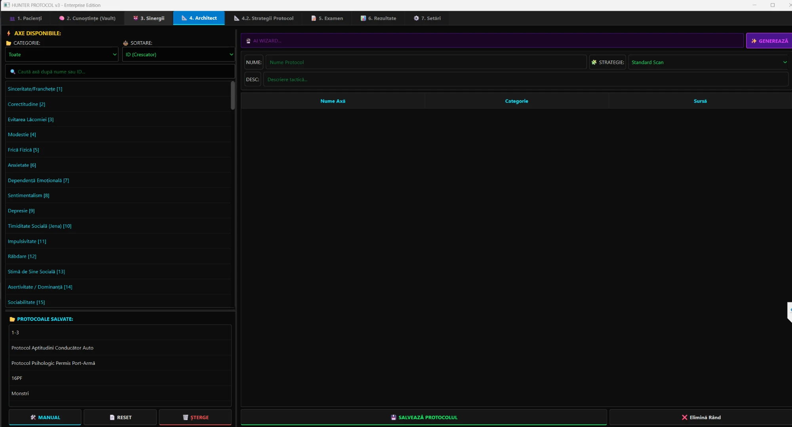

# 🧠 Hunter Protocol

**An adaptive psychometric assessment engine.** It probes 110 personality, career and clinical-risk dimensions with original questions, digs deeper where answers contradict each other, unlocks hidden "monster" axes when combinations of traits point to a risk, and builds a longitudinal profile across sessions. Optional Google Gemini agents then write the narrative reports.

I built it to analyse myself, from the inside, with more nuance than a fixed questionnaire allows.

**Tech:** Python · PySide6 (Qt) · SQLite · Google Gemini · PyInstaller · ~9,000 lines of application code

> ⚠️ **Not a medical device.** Hunter Protocol is a personal and research tool. It does not diagnose anything, and its questions are not a validated clinical instrument. Clinical axes are inspired by published constructs and only indicate patterns worth discussing with a professional.


*The test architect: pick axes from the catalogue (filtered by category, searchable), name the protocol and its strategy, or let the AI wizard propose the axes. Saved protocols on the left, including the examples shipped with the app.*

---

## ✨ What it does

### A knowledge base of 110 axes
| Category | Axes | Examples |
|---|---|---|
| Core personality | 39 | honesty, anxiety, assertiveness, conscientiousness (mapped to HEXACO, Big Five / NEO-PI-R facets, 16PF) |
| Clinical | 10 | depression, dissociation, somatisation |
| Career, style, values, EQ, cognition, bio, dating | 37 | burnout, leadership style, emotional intelligence |
| **Monsters** (risk constructs) | 24 | narcissism, psychopathy, Machiavellianism, burnout, ADHD-like executive dysfunction, borderline, impostor syndrome, flight risk, integrity risk |

- **1,101 original questions** in Romanian, written for this project (AI-assisted, see `docs/prompt_generator_ro.txt`), 4 scored options each (4,404 options). Each axis records which established framework inspired it (HEXACO, NEO-PI-R, MMPI, PID-5, Dark Triad, MBI, DSM-5…); the questions are not copied from those instruments.
- Questions are **versioned by a SHA-256 hash** of their text and options: edit a single letter and it becomes a new version, so old answers stay tied to the exact wording the person saw.

### A three-wave adaptive exam
1. **Wave 1, screening:** a few questions per axis selected by the test template.
2. **Wave 2, rigour:** axes whose answers are inconsistent or far from the norm get extra questions (yellow / red thresholds set per strategy).
3. **Wave 3, monsters:** **74 synergy rules** check combinations of scores (e.g. *low empathy + high dominance + low honesty*) and inject the matching hidden risk axis into the exam.

Every decision the engine takes (why an axis got more questions, why a monster was triggered) is written to an **audit trail** you can read afterwards.

### Longitudinal profile
Results accumulate into a **holistic profile** per person: latest score, confidence and how many distinct questions back it, across all sessions. Questions answered recently are not repeated within a configurable window (default: 6 months), so retesting measures change instead of memory.

### Test architect and strategies
- Build templates by picking axes (examples included: *16PF*, *Monsters*, *Driver aptitude protocol*, *Firearm permit psychological protocol*).
- An **AI architect** proposes 8–15 relevant axes for a stated purpose ("hiring a manager") and can draft new questions for an axis.
- **Strategies** tune the exam: base questions per axis, contradiction threshold, extra questions per deviation level, when monsters are injected.

### AI reports (optional)
Gemini writes reports in four voices: **HR** (performance, integrity, team fit), **Clinical psychologist**, **Academic** (dense, research-style) and **Longitudinal** (how the person changed over time). Several people can be analysed together for team dynamics. There is also a chat mode over the selected profiles.

### Offline exam package
Export a self-contained `exam_package.db`, give it to someone with the standalone examiner (`standalone_exam.py`, buildable as a single `.exe`), then import their answers back into the main app.

---

## 🛠️ Architecture

```
main.py                 entry point, global dark theme
config.py               paths: code here, personal data in ../Data
logic/                  business logic, no UI
  exam_engine.py        three-wave adaptive engine, audit trail, scoring
  patient_manager.py    people, holistic profile, reports
  knowledge_manager.py  axes and questions
  synergy_manager.py    monster rules
  strategy_manager.py   exam strategies
  architect_manager.py  test templates
ai_agents/              Gemini connector, profiler and architect agents
prompts/                AI personas as plain-text templates
ui/                     main window + 8 tabs (people, knowledge, synergies,
                        architect, strategies, exam, results, settings)
database/
  knowledge_base.db     the public knowledge base (no personal data)
  builders/ …           the scripts that generated it, one per axis
standalone_exam.py      offline examiner
```

The UI is in Romanian; code comments are mostly Romanian too.

---

## 🔒 Privacy by design

Personal data never lives inside the repository:

```
<root>/
├── Project/   this repository
└── Data/      hunter_protocol.db, pacienti/ (reports), user_settings.json, .env
```

- On first start, `Data/hunter_protocol.db` is created from `database/knowledge_base.db`.
- `.gitignore` additionally refuses databases, reports, JSON exports and `.env` files, in case one lands in the code folder by mistake.
- National ID numbers (CNP) are stored only as a hash.
- **AI reports send the selected profiles to Google Gemini.** Use them only with the person's consent; everything else works offline without an API key.

Set `HUNTER_DATA_DIR` to keep the data folder somewhere else (e.g. an encrypted drive).

---

## 🚀 Getting started

```bash
git clone https://github.com/mmereu97/hunter-protocol.git Project
cd Project
pip install -r requirements.txt
python main.py
```

For the AI features, create `../Data/.env`:
```ini
GOOGLE_API_KEY="your-key"
```

Build the standalone examiner:
```bash
pip install pyinstaller
pyinstaller standalone_exam.spec
```

More detail (in Romanian): [`docs/ARHITECTURA.md`](docs/ARHITECTURA.md), [`docs/BAZA_DE_DATE.md`](docs/BAZA_DE_DATE.md), and the full list of synergy rules in [`docs/sinergii.txt`](docs/sinergii.txt).

---

## 👤 Author

Mihai Mereu · [GitHub](https://github.com/mmereu97)
